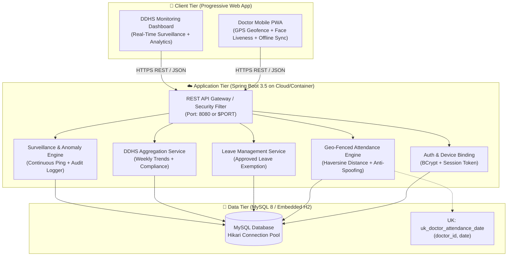

# 🏥 PHC Doctor Attendance System — API & Architecture Documentation

Comprehensive technical reference for the **PHC Doctor Attendance & Real-Time DDHS Surveillance System** built with **Java 21**, **Spring Boot 3.5**, **MySQL**, and **Modern Vanilla HTML5/CSS3/JS PWA**.

---

## 🏛️ 1. System & Deployment Architecture



### Deployment Topology
* **Container Environment**: Dockerized multi-stage build running on JDK 21 Alpine image. Compatible with Render, Railway, Koyeb, AWS ECS, or Google Cloud Run.
* **Database Resilience**: Configured with **HikariCP** connection pooling (`maximum-pool-size: 10`, `minimum-idle: 2`, `idle-timeout: 600000ms`). Supports dynamic cloud injection via `${SPRING_DATASOURCE_URL}`, `${SPRING_DATASOURCE_USERNAME}`, and `${SPRING_DATASOURCE_PASSWORD}` with automatic fallback to embedded H2 for seamless local developer testing.
* **Database Integrity**: Composite unique constraint `uk_doctor_attendance_date` on `(doctor_id, date)` guarantees zero duplicate attendance records, even under high-concurrency race conditions.

---

## 🔐 2. Authentication & Authorization

All authenticated endpoints accept a bearer session token in the HTTP `Authorization` header:
```http
Authorization: PHC_SEC_TOKEN_<uuid>
```
* **Doctor Role**: Authorized to submit check-in/out, presence pings, offline sync, apply for leave, and view their own attendance history.
* **Admin / DDHS Role**: Authorized to review pending leaves, view surveillance feeds, inspect audit logs, and access district analytics.

---

## 📡 3. REST API Endpoint Reference

### 3.1 Authentication (`/auth`)

| Method | Endpoint | Description | Auth Required |
| :--- | :--- | :--- | :--- |
| `POST` | `/auth/login` | Authenticates doctor or admin, binds hardware device ID | No |
| `POST` | `/auth/register` | Registers a new doctor under a designated PHC | No |
| `POST` | `/auth/reset-device-binding` | Unbinds doctor device ID (for phone replacements) | Admin / Self |
| `POST` | `/auth/logout` | Invalidates active session token | Optional |
| `GET` | `/auth/phcs` | Lists all registered PHCs with geofence coordinates | No |

#### `POST /auth/login` Request Sample:
```json
{
  "email": "doctor@phc.gov.in",
  "password": "SecurePassword123!",
  "deviceId": "PHC_DEV_a1b2c3d4"
}
```
#### Response (`200 OK`):
```json
{
  "message": "Login successful",
  "doctorId": 1,
  "name": "Dr. Arunkumar",
  "role": "DOCTOR",
  "token": "PHC_SEC_TOKEN_8f14b3d0...",
  "registeredDeviceId": "PHC_DEV_a1b2c3d4"
}
```

---

### 3.2 Doctor Attendance (`/attendance`)

| Method | Endpoint | Description | Auth Required |
| :--- | :--- | :--- | :--- |
| `POST` | `/attendance/checkin` | Verifies GPS coordinates inside PHC geofence + facial liveness | Doctor |
| `PUT` | `/attendance/checkout` | Records checkout, calculates hours worked, computes status | Doctor |
| `POST` | `/attendance/presence-ping` | Periodic background heartbeat verifying continuous presence | Doctor |
| `POST` | `/attendance/sync-offline` | Batch synchronizes cached check-ins recorded during offline mode | Doctor |
| `GET` | `/attendance/status/{doctorId}` | Retrieves today's real-time attendance status for a doctor | Doctor / Admin |
| `GET` | `/attendance/history/{doctorId}` | Retrieves chronological attendance history for a doctor | Doctor / Admin |

#### `POST /attendance/checkin` Request Sample:
```json
{
  "doctorId": 1,
  "latitude": 11.0168,
  "longitude": 76.9558,
  "accuracy": 12.5,
  "livenessScore": 0.96,
  "photoProof": "data:image/jpeg;base64,..."
}
```
#### Response (`200 OK`):
```json
{
  "message": "Check-in successful! Status: PRESENT. Verified distance to Thudiyalur PHC: 15m."
}
```

---

### 3.3 DDHS Executive Dashboard (`/dashboard`)

| Method | Endpoint | Description | Auth Required |
| :--- | :--- | :--- | :--- |
| `GET` | `/dashboard/summary/{divisionId}` | Key metric cards: total PHCs, total doctors, present, on-leave, absent | Admin |
| `GET` | `/dashboard/phc-overview/{divisionId}` | PHC-by-PHC compliance table with attendance percentages | Admin |
| `GET` | `/dashboard/analytics/{divisionId}` | 7-day weekly trends, PHC performance bars, and status breakdown | Admin |

#### `GET /dashboard/summary/{divisionId}` Response (`200 OK`):
```json
{
  "totalPhc": 8,
  "totalDoctors": 24,
  "presentDoctors": 21,
  "onLeaveDoctors": 2,
  "absentDoctors": 1
}
```

#### `GET /dashboard/analytics/{divisionId}` Response (`200 OK`):
```json
{
  "weeklyTrend": [
    { "date": "Mon", "percentage": 88, "presentCount": 21 },
    { "date": "Tue", "percentage": 92, "presentCount": 22 },
    { "date": "Wed", "percentage": 95, "presentCount": 23 },
    { "date": "Thu", "percentage": 87, "presentCount": 21 },
    { "date": "Fri", "percentage": 91, "presentCount": 22 },
    { "date": "Sat", "percentage": 79, "presentCount": 19 },
    { "date": "Sun", "percentage": 100, "presentCount": 24 }
  ],
  "phcStats": [
    { "phcName": "Thudiyalur PHC", "totalDoctors": 4, "present": 4, "absent": 0, "percentage": "100.00" }
  ],
  "statusBreakdown": {
    "present": 21,
    "late": 2,
    "onLeave": 2,
    "absent": 1
  }
}
```

---

### 3.4 Leave Management (`/leave`)

| Method | Endpoint | Description | Auth Required |
| :--- | :--- | :--- | :--- |
| `POST` | `/leave/apply` | Doctor submits leave request (Casual, Sick, Duty) with dates | Doctor |
| `GET` | `/leave/doctor/{doctorId}` | Retrieves leave request history for a specific doctor | Doctor / Admin |
| `GET` | `/leave/pending` | Lists all pending leave applications across the district | Admin (403 if Doctor) |
| `PUT` | `/leave/approve/{leaveId}` | Approves or rejects a leave application | Admin (403 if Doctor) |

#### `POST /leave/apply` Request Sample:
```json
{
  "doctorId": 1,
  "leaveType": "CASUAL_LEAVE",
  "startDate": "2026-11-05",
  "endDate": "2026-11-06",
  "reason": "Attending State Health Mission workshop"
}
```

---

### 3.5 Real-Time Surveillance & Audit (`/attendance`)

| Method | Endpoint | Description | Auth Required |
| :--- | :--- | :--- | :--- |
| `GET` | `/attendance/surveillance-feed` | Live notification feed of breaches, spoofs, and alerts | Admin |
| `GET` | `/attendance/audit/recent` | Recent 50 audit logs with GPS coordinates & verification flags | Admin |
| `GET` | `/attendance/audit/doctor/{doctorId}` | Full immutable audit trail for a specific doctor | Admin / Self |
| `GET` | `/attendance/anomalies` | Detected security anomalies (GPS spoofing, excessive breaches) | Admin |
| `GET` | `/attendance/absentee-alerts` | Automated absentee notifications triggered after cutoff | Admin |

---

## 🛡️ 4. Security & Compliance Controls

1. **Anti-Spoofing Travel Velocity Engine**: Calculates Haversine distance divided by elapsed time between consecutive GPS fixes. Velocity $> 250\text{ km/h}$ flags `FLAGGED_IMPOSSIBLE_SPEED` and rejects check-in.
2. **Hardware Device Binding**: Doctors are bound to a verified hardware device ID upon first login. Login from an unrecognized device is blocked until unverified or cleared by DDHS admin.
3. **Facial Liveness Proof**: Check-in requires optical verification with a liveness confidence score $\ge 0.70$.
4. **Race-Condition Safe Attendance**: Composite database constraint `uk_doctor_attendance_date` rejects concurrent duplicate check-ins at the database level.
5. **Continuous Presence Heartbeat**: Random background pings enforce that the doctor remains within the designated PHC perimeter throughout duty hours.
